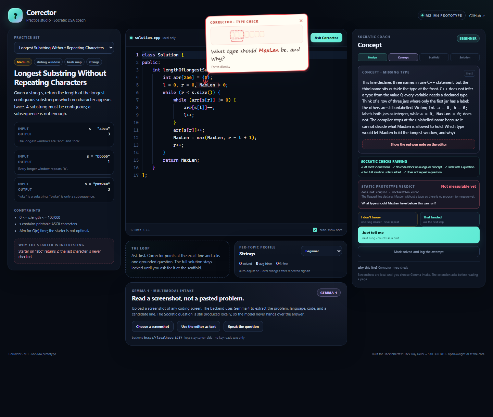

# Corrector

> A Socratic DSA coach that lives beside your coding session. When you get stuck, it reads
> the screen, points at the exact line, and asks the next question instead of handing over
> the answer.

**Status: M2–M4 working prototype.** This repo now contains a Manifest V3 side panel, a
local Monaco practice studio, live-page code reading, a shared red-pen overlay, a FastAPI
backend for Gemma 4 multimodal intake, and a tested Socratic contract. The prototype was
built for Hacktoberfest Hack Day Delhi × SKILLOP DTU.



*The practice studio: a detector finds the missing type on line 5, the coach asks one
grounded question, and all five Socratic checks pass before display. The note is a
question, not the reference product's direct correction. See
[docs/PROTOTYPE.md](docs/PROTOTYPE.md) and [docs/VISUAL.md](docs/VISUAL.md).*

## The loop

1. You solve a problem in the practice studio or on a coding tab.
2. You get stuck halfway through an approach.
3. You click Corrector (`Ctrl+Shift+Y`). The side panel opens beside the page.
4. **Read the code on this page** reads the visible editor through `activeTab` +
   `scripting`; **Read this screen** captures the tab for Gemma intake.
5. Corrector asks **one grounded question at a time**. A red-pen note appears next to the
   relevant line, with a hand-drawn arrow pointing at the token. Your answer changes the
   next question.
6. The full solution stays locked until you explicitly ask after the scaffold. Even then,
   the turn ends with a question.

## What works today

- **MV3 extension**: side panel, toolbar action, `Ctrl+Shift+Y`, local screen capture,
  on-demand `scripting` page reads, and the shared overlay renderer.
- **Practice studio** (`apps/web`): React + local Monaco, two original problems, C++ and
  Python starters, a live coach, per-topic profile controls, and a Gemma intake panel.
- **Live page reader**: a MAIN-world extractor for the practice bridge, Monaco,
  CodeMirror, textarea, and `<pre>` fallbacks, with LeetCode statement heuristics.
- **Socratic contract as code** (`packages/core`):
  - at most two questions per response;
  - no code block on the nudge or concept rung;
  - every response ends with a question;
  - no full solution without an explicit ask after pseudocode;
  - a repeated question is rejected.
- **Red-pen overlay** (`packages/overlay`): line-first anchoring, whitespace-normalised
  text fallback, Shadow DOM, hand-drawn arrow, and a small animated SVG explainer
  (moving window, hash-map lookup, stack, or pointer). `Esc`/`×` dismissal and reduced
  motion are supported. Used by both the practice studio and the extension.
- **Hint ladder and answers**: nudge → concept → scaffold → solution; "I don't know"
  moves one rung and never repeats the question; "Just tell me" advances one rung and
  counts as a hint.
- **Per-topic personalisation**: auto-adjust after three fast solves or repeated struggle,
  manual override, mistake journal, preferred question type, and a visible summary.
- **Static verdict**: `assessSolution` labels a readable approach as likely optimal,
  brute force, or not measurable yet, with the complexity, evidence, and an improvement
  question. It is static structure only; the runner and measured growth are M5/M8.
- **Voice question**: the practice studio uses the browser Web Speech API to transcribe a
  spoken question and sends the transcript as text. Gemma does not receive raw audio.
- **Gemma 4 intake** (`services/api`): FastAPI, strict JSON schema, image validation, one
  repair attempt, and a text-only local fallback when no key is configured. Gemma reads
  the screen; the local coach asks the question.

## Quick start

Requires Node 20+ and Chrome/Edge 116+.

```bash
npm install
npm run build
```

Load the extension:

1. Open `chrome://extensions`.
2. Turn on **Developer mode**.
3. Choose **Load unpacked** and select `apps/extension/dist`.
4. Open the practice studio at `http://localhost:5173` and click the Corrector toolbar
   icon **on that tab**, or press `Ctrl+Shift+Y`.

Start the practice studio:

```bash
npm run dev:web
```

Open `http://localhost:5173`. The default problem is Longest Substring; its starter has a
missing `int` on line 5, so the note should point at `MaxLen`. Add `?demo=1` to ask the
first question automatically (useful for screenshots):
`http://localhost:5173/?demo=1`.

Start the Gemma backend:

```bash
cd services/api
python -m venv .venv
# Windows: .\.venv\Scripts\activate
# macOS/Linux: source .venv/bin/activate
pip install -r requirements-dev.txt
cp .env.example .env
# Put a fresh key from Google AI Studio in services/api/.env:
# GEMINI_API_KEY=...
uvicorn app.main:app --host 127.0.0.1 --port 8787
```

The extension's manifest allows `http://localhost:8787/*` and
`http://127.0.0.1:8787/*`; the backend allows the Vite origin and
`chrome-extension://*`.

With no key, the backend still serves `GET /health` and a **text-only** local fallback for
`POST /v1/intake`. Image-only requests return `503` with a clear message. The practice
studio's **Use the editor as text** button demonstrates that fallback; the screenshot path
is the real Gemma path once a key is configured.

### “Could not read this tab”

`activeTab` is temporary. It is granted when you click the Corrector toolbar icon **on the
coding tab**, and Chrome revokes it when that tab reloads or navigates. If you see
“Chrome did not grant access to this tab”:

1. Open the normal `http(s)` coding page you want to read.
2. Click the Corrector toolbar icon on that tab. Do not open the side panel from Chrome's
   side-panel menu, and do not switch tabs after clicking.
3. Try **Read the code on this page** again.

After a rebuild, reload the extension card before testing. `chrome://`, the New Tab page,
and the Chrome Web Store cannot be read or captured.

## Verify

```bash
npm run verify
npm test
npm run typecheck

cd services/api
.venv/Scripts/python -m pytest -q   # Windows
# or: .venv/bin/python -m pytest -q # macOS/Linux
```

Current evidence: typecheck passes for core, overlay, extension, and web; 47 unit tests
(including 6 live-coach tests) pass; extension and web production builds pass; 10 backend
tests pass. Manual checks: the text fallback anchors line 5 at `MaxLen`, the practice
studio renders the red-pen note with its animated explainer, the static verdict is
visible, and all five Socratic checks pass.

## What is intentionally not built yet

- **M5**: Pyodide execution, runner, and error capture.
- **M6**: open-weight reasoning model on a GPU Droplet with vLLM. The current hints are
  deterministic, detector-specific banks.
- **M7**: IndexedDB persistence for the profile and journal.
- **M8**: measured complexity and the optimal-vs-brute-force verdict from execution.
- **M9–M13**: animated visual-spec library, dashboard, voice, LoRA training, benchmark,
  and DEV write-up.

The current verdict is demo data. The real verdict will come from the runner and static
analysis, never from the model's opinion alone. The LeetCode adapter is experimental and
will break when LeetCode changes its DOM.

## Architecture at a glance

```text
┌──────────────────────────── Browser ────────────────────────────┐
│  Practice studio (Monaco)   Coding site (LeetCode / other)       │
│        │ code + statement          │ visible code / screenshot    │
│        ▼                          ▼                             │
│  MV3 side panel ◄── runtime messages ── service worker           │
│        │  Socratic contract (core)      │ captureVisibleTab       │
│        │  local profile                 │ scripting (on demand)   │
│        ▼                                ▼                        │
│  red-pen overlay (shared Shadow DOM)                            │
└────────┬────────────────────────────────────────────────────────┘
         │ HTTPS (screenshot only after an explicit click)
         ▼
   FastAPI backend ──► Gemma 4 via Gemini API (intake only)
         │
         └── text-only local fallback when no key is configured
```

The extension never holds an API key and never calls Gemini directly. Profile and journal
stay local (in memory in this prototype). Only the current request's context leaves the
browser. The target design, model split, and trust boundaries are in
[docs/ARCHITECTURE.md](docs/ARCHITECTURE.md).

## Socratic method and personalisation are code

This is the part that must not drift into a generic "explain my code" chatbot:

- [docs/SOCRATIC.md](docs/SOCRATIC.md) — the 14 rules, how each is enforced, the ladder
  state machine, answer handling, and the exact checks.
- [docs/PERSONALISATION.md](docs/PERSONALISATION.md) — level per topic, hint style,
  starting rung, auto-adjust thresholds, journal, and what the prompt receives.
- [docs/VISUAL.md](docs/VISUAL.md) — the red-pen note, placement, anchoring,
  accessibility, and prior art.
- [docs/PROTOTYPE.md](docs/PROTOTYPE.md) — M2–M4 scope, demo script, evidence, and honest
  boundaries.
- [`packages/core/src/policy.ts`](packages/core/src/policy.ts) — checks and fallback.
- [`packages/core/src/live.ts`](packages/core/src/live.ts) — live detectors and hint banks.
- [`packages/core/src/ladder.ts`](packages/core/src/ladder.ts) — hint ladder.
- [`packages/core/src/profile.ts`](packages/core/src/profile.ts) — per-topic stats and
  auto-adjust.
- [`packages/core/src/prompts.ts`](packages/core/src/prompts.ts) — the system prompt for
  the future model.

## Repo layout

```text
apps/
  extension/        MV3 side panel, live page reader, Gemma bridge, overlay demo
  web/              practice studio (React + Monaco) and screenshot intake
packages/
  core/             Socratic contract, ladder, profile, prompts, live detectors
  overlay/          shared red-pen renderer
services/
  api/              FastAPI + Gemma 4 intake + local text fallback
docs/               product, Socratic contract, personalisation, privacy, prototype
training/           teacher-generated data and LoRA adapters (M12)
benchmark/          model comparison and Socratic quality benchmark (M13)
scripts/            icon generation
```

## Permissions and privacy

| Permission | Why |
| --- | --- |
| `sidePanel` | Show the coach beside the page. |
| `activeTab` | Capture or read only the tab where you invoked Corrector. |
| `scripting` | Read code and inject the red-pen note on demand. |

Host access is limited to the local backend (`localhost:8787` and `127.0.0.1:8787`).
There is **no** `<all_urls>` host permission, no persistent content script, and no `tabs`
browsing-history permission. Page access starts only when you invoke Corrector on a tab.
The screenshot stays in the side panel's memory until you press Gemma intake; only then is
one image sent to your backend. See [docs/PRIVACY.md](docs/PRIVACY.md) for the full data
map.

## Roadmap

- [x] **M1** Repo skeleton, MV3 side panel, shortcut, Socratic contract, per-topic
  profile, demo loop, and the red-pen overlay renderer.
- [x] **M2** Practice website with Monaco + FastAPI skeleton (local; deployment is a
  separate step).
- [x] **M3** Read code from the practice page and supported editors, then wire the on-page
  note to a live anchor.
- [x] **M4** Gemma 4 intake (screenshot → structured JSON) with tests and a labelled local
  fallback.
- [ ] **M5** Pyodide execution, runner, and error capture.
- [ ] **M6** Open reasoning model on the GPU Droplet with vLLM.
- [ ] **M7** IndexedDB profile and hint ladder wired end to end.
- [ ] **M8** Complexity measurement and the optimal-vs-brute-force verdict.
- [ ] **M9** Animated pop-ups: visual spec schema, five components, mascot.
- [ ] **M10** Mistake journal, edge-case prompts, pattern tags, dashboard.
- [ ] **M11** Voice, explain-aloud mode, speech output.
- [ ] **M12** Teacher-generated data, LoRA adapters, adapter serving.
- [ ] **M13** Evaluation, demo, DEV write-up.

## License

MIT. See [LICENSE](LICENSE).
