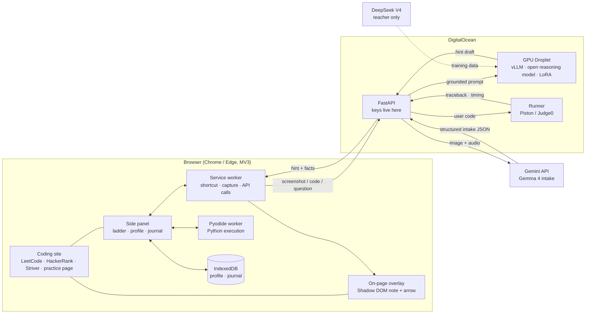
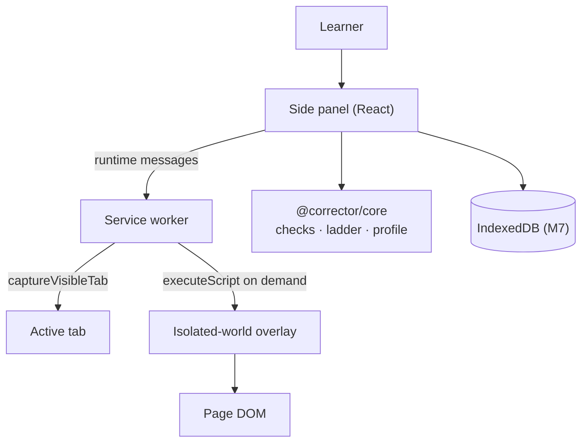

# Architecture

Corrector is a browser extension, not a desktop app. The extension is the thin, private edge; the models and the runner are swappable services behind it.

This document describes the target architecture and marks what the M2–M4 prototype
actually implements. The current build has the practice studio, live page reader, shared
overlay, static verdict, and Gemma 4 intake; the reasoning model, runner, persistence, and
voice audio model are still target architecture.

## System picture



## Responsibilities

| Component | Owns | Does not own |
| --- | --- | --- |
| **Side panel** | Ladder UI, profile, journal, answer handling, policy-check display | Page DOM, API keys, model inference |
| **Service worker** | Shortcut, `captureVisibleTab`, on-demand injection, backend calls | Long-lived state (MV3 workers are ephemeral) |
| **Injected overlay** | Finding the anchor, drawing the note/arrow, scroll tracking | Deciding what the hint says |
| **`@corrector/core`** | Socratic checks, ladder, level rules, prompt builder, demo fixtures | Browser APIs, network, model calls |
| **FastAPI backend** | Gemini key, model routing, prompt assembly, rate limits, logging policy | Running user code on the API host |
| **GPU Droplet** | Open reasoning model behind an OpenAI-compatible endpoint, LoRA adapters | Holding user accounts or long-term history |
| **Runner** | Isolated execution, time/memory limits, traceback capture | Trusting user code |

## Model split: two jobs, no blur

### Gemma 4 = intake only

Gemma 4 is called through the Gemini API on the backend, not from the extension. It handles the multimodal input that text models are bad at:

- screenshot → problem statement, visible code, language, error text;
- voice note → a short spoken question, in the learner's words.

It returns strict JSON:

```json
{
  "problem_statement": "…",
  "language": "cpp",
  "code": "…",
  "error_text": "…",
  "spoken_question": "…",
  "anchor": { "line": 5, "anchor_text": "MaxLen" }
}
```

The UI shows a small "Gemma read this" line so its role is visible in the demo. Gemma does **not** decide the next hint. That keeps the reasoning model's job clean and makes the intake step replaceable.

### Open reasoning model = the coach

The reasoning model is the best open-weight coding model that fits the GPU Droplet. Candidates to verify on their model cards at build time:

- **Qwen3-Coder** (≈30B total / 3.3B active) — strong code reasoning, good size for a single Droplet.
- **JetBrains Mellum2** (12B / 2.5B active, Apache 2.0) — smaller and faster; verify instruction quality for Socratic dialogue.

DeepSeek V4 (MIT) is too large to host on the available Droplet. It is the **teacher**: it writes hints at all three levels for the training set in M12. It is never the production coach.

The backend talks to the reasoning model through an OpenAI-compatible endpoint (`REASONING_BASE_URL`, `REASONING_MODEL`, `REASONING_API_KEY`). Swapping to Ollama locally is a config change. vLLM serves the base model and the LoRA adapters.

### Why two models

- Gemma's vision/audio is the right tool for "what is on the screen?".
- A code-specialised open model is the right tool for "what is the next Socratic question?".
- A closed teacher model is the right tool for generating training data at scale, not for serving every learner request.

## Request lifecycle

1. **Trigger.** The learner clicks the extension or presses `Ctrl+Shift+Y`. The side panel opens on the current tab.
2. **Capture.** `Read this screen` sends a message to the service worker, which calls `chrome.tabs.captureVisibleTab` under `activeTab`. The screenshot is held in panel memory in M1.
3. **Intake (M4).** The panel sends the screenshot (and optional voice transcript) to FastAPI. The backend calls Gemma 4 and validates the JSON.
4. **Grounding.** The backend runs or retrieves deterministic facts:
   - the traceback from the runner;
   - a failing test case;
   - the measured growth curve;
   - static analysis (nested loops, pattern).
5. **Policy context.** The panel sends the per-topic level, preferred question type, asked questions, and ladder rung. The backend builds the system prompt with `buildSocraticSystemPrompt`.
6. **Generation.** The reasoning model returns one draft.
7. **Check and regenerate.** The backend (and, for local drafts, the client) runs `checkHint`. On failure, it asks for a revision with the failure instructions, up to two times, then falls back to a grounded question.
8. **Render.** The panel shows the hint and the check strip. The overlay points at the anchored line. The learner answers; the ladder moves.
9. **Log.** The attempt updates the local profile and journal. Level changes are deterministic and explained in the UI.

## Deterministic facts

The model may explain these; it may not invent them.

| Fact | Source | Used for |
| --- | --- | --- |
| Traceback / error text | Runner or intake | Grounded first question. |
| Failing case | Runner or problem fixtures | "Wrong" counterexample questions. |
| Measured growth | Execute at `n = 10^2 … 10^5`, fit the curve | Optimal vs brute-force verdict. |
| Nested loops / pattern | `ast` for Python; `tree-sitter` for other languages | Static evidence to corroborate the measurement. |
| Optimal pattern | Pattern detector / curated map | Improvement question (not the answer). |
| Anchor line/token | Page adapter or intake | On-page note placement. |

The verdict is stated plainly because it is measured. The improvement is still a question.

## Extension execution contexts



- **Side panel:** the only long-lived UI. It owns the session state and the profile. It is opened from our `chrome.action.onClicked` handler with `sidePanel.open`, not the built-in `openPanelOnActionClick` behavior: the action click is the user gesture that grants `activeTab` for the screenshot.
- **Service worker:** ephemeral. It must not rely on globals; store session data in `chrome.storage.session` or the panel. It returns `true` from async `onMessage` handlers.
- **Injected overlay:** created on demand with `activeTab` + `scripting`; it runs in the isolated world but shares the DOM. It draws in a Shadow DOM host. It is idempotent and cleans up on `Esc`/`×` and navigation.
- **No persistent content script in M1.** We do not request `<all_urls>`. When we add site adapters, we still prefer on-demand injection.

## Permissions

| Permission | When | Why |
| --- | --- | --- |
| `sidePanel` | Install | Show the coach beside the page. |
| `activeTab` | User invokes the extension on a tab | Capture the visible tab and, in M3, inject the overlay. |
| `scripting` (M3) | User invokes the extension | Inject the overlay renderer on demand. No install-time host access. |

No `tabs` permission for reading browsing history, no `<all_urls>` at install time, no content script on every page. The trade-off is more activation/cleanup logic, which is the right trade for a learning tool.

## Security and privacy boundaries

- **Keys:** Gemini and reasoning-model keys live only in backend environment variables. The extension has no key and makes no direct Gemini call. `.env` is gitignored; `.env.example` is the contract.
- **User code:** Python runs in a Pyodide Web Worker in the browser; other languages go to a self-hosted Piston/Judge0 with isolation and limits. User code never runs on the API host. The runner has no network and a hard timeout.
- **Page content:** read only for the current session. We do not store or republish third-party problem statements. The overlay reads the anchor, not the whole page, and the screenshot is local in M1.
- **Model output:** inserted as text, never HTML. The overlay uses text nodes; the side panel's rich-text renderer escapes content and only formats code blocks.
- **Profile:** local-first. In M1 it is in memory; M7 moves it to IndexedDB. Export/import and deletion are planned.
- **Logging:** no analytics in M1. The backend will log request metadata (latency, check pass rate) without code/problem text by default; any training-data capture requires explicit consent.

## Failure modes and fallbacks

| Failure | Fallback |
| --- | --- |
| `captureVisibleTab` blocked (`chrome://`, no activeTab grant) | Explain how to invoke Corrector on a normal tab; offer the demo. |
| Gemma intake returns invalid JSON | One repair attempt; then ask the learner to paste the code or use the side panel. |
| Anchor not found on the page | Show the hint in the side panel; if a screenshot exists, crop the region and draw the arrow on the image. |
| Reasoning model times out | Try Ollama/local; then show a grounded fallback question from `buildFallbackQuestion`. |
| Policy check fails twice | Show the fallback question, not a contract-breaking draft. |
| Runner unavailable | Use the last known facts; ask a question about the traceback the learner can see. |
| Tab navigated mid-session | Stop the overlay, keep the panel state, re-anchor on the next capture. |

## M1 scope vs target

| Layer | M1 | Target |
| --- | --- | --- |
| Extension shell | MV3 side panel + shortcut + action | Same |
| Screen capture | Local preview, `activeTab` | Gemma intake (M4) |
| On-page note | Renderer + local demo page | Live anchor via site adapters (M3) |
| Socratic contract | Implemented and tested in core | Server-side second pass + benchmark (M6, M13) |
| Profile | In-memory demo, deterministic rules | IndexedDB + retrieval (M7, M10) |
| Reasoning model | Demo fixtures | vLLM on GPU Droplet (M6) |
| Runner | None | Pyodide + Piston/Judge0 (M5) |
| Optimality | Static demo verdict | Measured growth + static analysis (M8) |
| Animation | Single note/arrow | Visual-spec library (M9) |
| Training | None | Teacher data + LoRA (M12) |

## Facts to verify before each integration

- The exact Gemma 4 model ID and its vision/audio support in the Gemini API at build time.
- The vLLM/PEFT LoRA compatibility for the chosen base model.
- GPU Droplet size, price, region, and cold-start behavior.
- The license of every open-weight model before publishing an adapter or claiming open-source compliance.
- The DOM structure of each target site before promising an anchor; sites change.

## References in the repo

- [`packages/core/src/policy.ts`](../packages/core/src/policy.ts) — checks, regeneration, fallback.
- [`packages/core/src/ladder.ts`](../packages/core/src/ladder.ts) — ladder state machine.
- [`packages/core/src/profile.ts`](../packages/core/src/profile.ts) — per-topic profile and auto-adjust.
- [`packages/core/src/prompts.ts`](../packages/core/src/prompts.ts) — system prompt.
- [`apps/extension/src/overlay/annotation.ts`](../apps/extension/src/overlay/annotation.ts) — on-page renderer.
- [`docs/VISUAL.md`](VISUAL.md) — visual contract.
- [`docs/PRIVACY.md`](PRIVACY.md) — data map.
