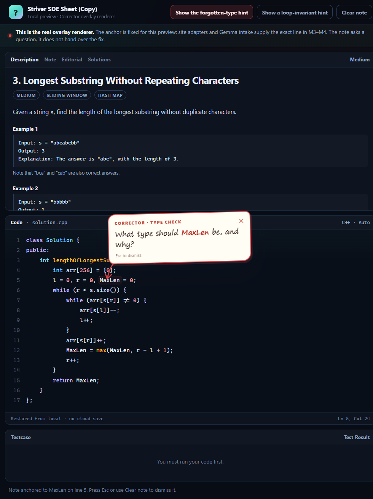

# Milestone 1 — the Socratic loop, end to end in a local slice

**Status: historical milestone record.** The current working prototype is documented in
[PROTOTYPE.md](PROTOTYPE.md). This page preserves the M1 scope and acceptance notes.



M1 is not a mockup. It is a working Manifest V3 extension with a tested Socratic contract, a per-topic personalisation model, a local screen-capture path, an optimality verdict, and a real on-page annotation renderer with a preview page.

There are no model calls yet. The demo fixtures are labelled as demo data.

## What is in the milestone

### 1. Repository and build

- npm workspaces: `apps/*`, `packages/*`.
- TypeScript strict config shared by core and extension.
- Vite 8 + React 19 + TypeScript.
- Vitest 5.
- MIT license.
- `.gitignore` covers `dist/`, `.env`, model/training artefacts.
- `.env.example` documents the future backend keys without values.
- `npm run verify` runs typecheck + tests + production build.

### 2. MV3 extension shell

- `apps/extension/public/manifest.json` — MV3, `sidePanel`, `activeTab`, icons, command.
- Toolbar action opens the side panel.
- `Ctrl+Shift+Y` / `Cmd+Shift+Y` opens the side panel.
- If `chrome.sidePanel.open` fails, a normal extension tab is opened.
- Only the side panel and the visible-tab capture are accessible; no content script on every page, no `<all_urls>`.
- Generated 16/32/48/128 PNG icons (no binary asset hand-waving; the generator is in `scripts/`).

### 3. Screen capture path

- Start screen explains the loop: solve → click Corrector → read the screen → answer one question.
- **Read this screen** sends `corrector:capture-screen` to the service worker.
- The worker calls `chrome.tabs.captureVisibleTab({ format: "png" })` under `activeTab`.
- The screenshot is shown back in the panel with its size and time, held in React state, not written to disk or uploaded.
- Errors are explained: `chrome://` pages, tabs where the extension was not invoked, or a tab that was navigated after invocation.
- The `activeTab` grant is temporary and tied to the invoked tab; the UI says so.

### 4. Socratic contract (`packages/core`)

- `checkHint` runs five checks on every response:
  - at most 2 questions;
  - no code block on nudge/concept;
  - ends with a question;
  - no full solution without an explicit request after pseudocode;
  - no repeated question.
- `enforcePolicy` regenerates up to twice with the failure instructions, then falls back to a grounded question.
- `buildFallbackQuestion` is grounded in the failing case, traceback, measured growth, or problem.
- The prompt builder encodes the 14-rule contract, rung guides, level guides, facts, profile, asked questions, answer handling, tone, and language.
- The theme/level/rung text is plain prose; the side panel renders it with a safe rich-text renderer.

### 5. Ladder and answer handling

- Rungs: nudge → concept → pseudocode → solution.
- Starting rung: beginner `concept`, intermediate/advanced `nudge`.
- The ladder moves only when the learner asks.
- **Just tell me** always advances one rung and counts as a hint; on pseudocode it reveals the solution.
- **I don't know** moves one rung more explicit and remembers the question; after two in a row on the same point, it switches to a direct 2–3 sentence explanation plus one check question.
- **Wrong** produces a counterexample question from the demo's failing case `[3, 3] → []`.
- **Correct** confirms and asks the next step.
- **Partly right** names the right part and probes the missing part.
- The full solution still ends with a question, satisfying the "ends with a question" rule.

### 6. Per-topic personalisation

- `LearnerProfile` with `topics`, each with its own level, attempts, solves, hints, fast-solve count, struggle streak, manual override, `unlockedBy`, and journal.
- Level dropdown sets a manual override; **resume auto-adjust** clears it.
- Auto-adjust:
  - three consecutive fast solves (only the first hint, no escape hatch) → level up;
  - two consecutive struggles (escape hatch, pseudocode/solution, or two "I don't know") → level down.
- A beginner can level up with only the first concept hint; requiring a literal nudge would make level-up impossible at that rung. This is documented in `docs/PERSONALISATION.md`.
- The mistake journal records problem, pattern, mistake type, unlocking question type, hints, solved, and timestamp; newest first, capped at 50.
- Preferred question type is deterministic; `example` is preferred in the demo (3 unlocks).
- The profile summary and preferred type reach the system prompt.
- The demo profile is clearly labelled and starts at 3/4 solved, 1.8 average hints, with two journal entries.

### 7. Optimality verdict

- **Check my solution** logs the attempt against the deterministic rules.
- The verdict card states the measured demo facts plainly:
  - nested loops detected;
  - 4.8 s at n = 100,000;
  - quadratic growth.
- The improvement is a question: *"Your code scans the array once for every element — what would let you skip the repeat scan?"*
- The verdict question passes all five policy checks; the check strip is shown.
- The card is explicit that the real verdict will come from the runner and static analysis, not the model's opinion.

### 8. On-page annotation renderer (new, from the visual reference)

- `apps/extension/src/overlay/annotation.ts` is a self-contained renderer:
  - finds the smallest visible element containing the anchor text, preferring code editors;
  - draws a hand-drawn red note and arrow in a Shadow DOM host;
  - highlights the token with a dashed box;
  - places the note above the line first, then right/left/below;
  - tracks scroll and resize with `ResizeObserver`;
  - dismisses with `Esc` or `×`;
  - respects `prefers-reduced-motion`;
  - inserts model text as text nodes, never HTML.
- `apps/extension/overlay-demo.html` + `src/overlay-demo.ts` mock the Striver two-pane layout and use the same renderer. The note auto-shows after 650ms; two buttons show a forgotten-type question or a loop-invariant question; Clear removes it.
- The side panel links to **See the hand-drawn on-page note style →**.
- The note is a question, not the reference's direct "you forgot `int`". The visual manner is borrowed; the Socratic contract is preserved.
- Live site adapters, iframe handling, and Gemma-supplied anchors are M3–M4.

### 9. Documentation

- `README.md` — quick start, loop, what works, limitations, permissions, roadmap.
- `docs/PRODUCT.md` — the full product plan.
- `docs/SOCRATIC.md` — the 14 rules and the exact checks.
- `docs/PERSONALISATION.md` — per-topic levels, auto-adjust, journal, tiers.
- `docs/ARCHITECTURE.md` — system diagram, model split, request lifecycle, security.
- `docs/VISUAL.md` — the red-pen overlay contract and prior art.
- `docs/DECISIONS.md` — the ADRs.
- `docs/PRIVACY.md` — the data map and permission rationale.
- Placeholder READMEs for `apps/web`, `services/api`, `training`, `benchmark`.

## File map

```text
Corrector/
├── apps/
│   ├── extension/
│   │   ├── public/manifest.json
│   │   ├── sidepanel.html
│   │   ├── overlay-demo.html          ← visual preview
│   │   ├── src/
│   │   │   ├── background.ts          ← shortcut, side panel, capture
│   │   │   ├── overlay/
│   │   │   │   └── annotation.ts      ← real on-page renderer
│   │   │   ├── overlay-demo.ts        ← mock Striver page
│   │   │   ├── overlay-demo.css
│   │   │   └── sidepanel/
│   │   │       ├── App.tsx
│   │   │       ├── components.tsx
│   │   │       ├── main.tsx
│   │   │       └── styles.css
│   │   └── vite.config.ts
│   └── web/                           ← M2 placeholder
├── packages/
│   └── core/
│       ├── src/
│       │   ├── demo.ts
│       │   ├── index.ts
│       │   ├── ladder.ts
│       │   ├── policy.ts
│       │   ├── profile.ts
│       │   ├── prompts.ts
│       │   ├── questions.ts
│       │   ├── prose.ts
│       │   └── types.ts
│       └── test/                      ← 41 tests
├── services/api/                      ← M2 placeholder
├── training/                          ← M12 placeholder
├── benchmark/                         ← M13 placeholder
├── docs/
├── scripts/generate-icons.mjs
└── package.json
```

## How to verify

```bash
npm install
npm run verify
```

Expected: typecheck passes, 41 tests pass, production build succeeds.

Load the extension:

1. `chrome://extensions` → Developer mode → **Load unpacked** → `apps/extension/dist`.
2. Open a normal `http(s)` tab, click the Corrector icon or press `Ctrl+Shift+Y`.
3. The side panel opens.

Manual acceptance:

- [ ] The side panel opens from the toolbar action and the shortcut.
- [ ] **Read this screen** shows a screenshot preview of the active tab; the size/time are shown; nothing is uploaded.
- [ ] On a `chrome://` page or after navigating the tab, the capture error explains the activeTab rule.
- [ ] **Try the demo problem first** opens the concept hint (beginner) with the check strip all green.
- [ ] **I don't know** moves concept → pseudocode (one rung) and the new question is different.
- [ ] A second **I don't know** on the same point produces the direct explanation (2–3 sentences) and a check question.
- [ ] **Just tell me** on pseudocode reveals the full solution, which still ends with a question; the check strip allows the code block at the solution rung.
- [ ] **Check my solution** shows the brute-force verdict, the measured evidence, and the improvement question; the profile's solved/attempts/hints update; the notice explains any level change.
- [ ] The level dropdown changes the hint style; **resume auto-adjust** clears the manual override.
- [ ] The overlay preview auto-shows a note anchored to `MaxLen`, with a hand-drawn arrow; **Show a loop-invariant hint** re-anchors; **Clear note** removes it; `Esc` removes it.
- [ ] No network requests are made by the extension (DevTools → Network).

## Demo script (about 90 seconds)

1. Open the Striver tab (or any coding tab) and click Corrector. Say: "The coach lives beside the page; it does not ask you to paste your code."
2. Press **Read this screen**. The screenshot appears. Say: "This is the exact input Gemma will turn into problem, code, error, and anchor JSON in M4. In M1 it stays local."
3. Click **Try the demo problem first**. The beginner concept hint appears with the check strip. Point out the ladder and the policy checks.
4. Click **I don't know** once. The ladder moves to scaffold; the question changes. Click it again; the direct explanation appears (the one exception).
5. Click **Just tell me the solution**. The full solution is revealed because you asked after pseudocode. It still ends with a question.
6. Click **Check my solution**. The measured verdict says brute force; the improvement is a question. The profile updates.
7. Open **See the hand-drawn on-page note style →**. The note is anchored to `MaxLen` with a red arrow. Say: "This is the real renderer. The reference was a red pen; the note asks a question instead of giving the fix. Site adapters and Gemma supply the anchor next."

## Known limitations (deliberate, not hidden)

- No Gemma or reasoning-model call. All hints and the verdict are demo fixtures.
- No live page reading or live anchor. The overlay preview uses a fixed anchor in a local mock page.
- No persistence. Reloading the side panel resets the profile; IndexedDB is M7.
- `Check my solution` always logs a solved Two Sum attempt; it does not inspect the learner's actual code.
- The verdict is static demo data; the runner and complexity measurement are M5/M8.
- The website, FastAPI backend, GPU Droplet, voice, training, and benchmark are not built yet.
- The overlay renderer does not yet handle iframes, Monaco virtualization edge cases, or SPA route changes; those are M3.
- The screenshot is lost when the panel closes; no storage in M1.

## Next milestone

**M2: the practice website with Monaco + the FastAPI skeleton on a DigitalOcean Droplet.**

Why this order: the practice page is a safe, controlled environment to prove the live anchor and the side-panel ↔ page bridge before adapting to Striver/LeetCode. The on-page renderer is already written; M2 wires it to a real Monaco editor and a real hint payload. M3 brings the adapter to a live site; M4 brings Gemma intake.

We stop here until the learner says **done**.
